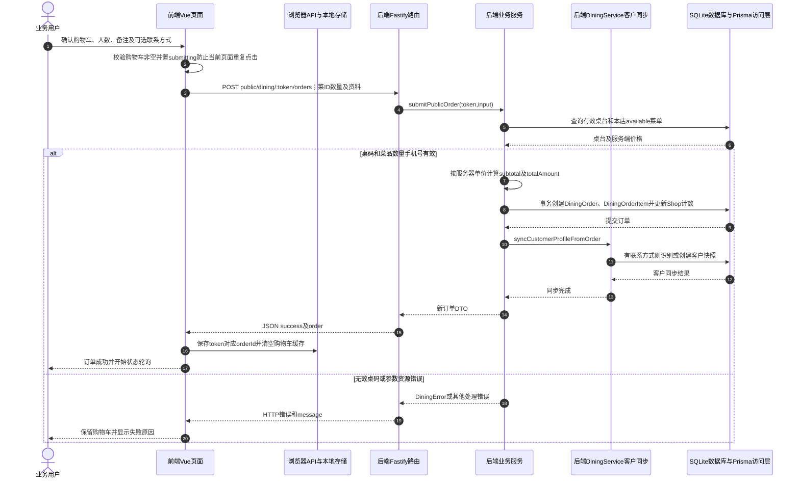

# ⑨ 扫码点餐与堂食订单 / 05 顾客首次下单

**实现状态：已实现** · 核对日期：2026-10-27

以下两图依据当前源码；仅对已存在链路作实现描述。尚未实现的范围在边界中说明。

## 业务范围与数据契约

| 项目 | 说明 |
| --- | --- |
| 入口与触发 | 手机顾客点餐页提交按钮 |
| 状态 | 已实现 |
| 接口与关键入参 | POST /api/v2/public/dining/:token/orders；{customer_phone?,customer_name?,remark?,people_count?,items} |
| 主要调用 | submitPublicOrder |
| 读取或写入数据 | 有效桌台、在售菜单和当前菜品价格 |
| 核心处理 | 校验手机号、数量1-99；服务端按菜单价格计算，创建pending/unpaid订单及明细 |
| 响应与数据去向 | status、message、order |

## 业务流程图

```mermaid
flowchart TD
  N1(["开始"])
  N2["用户 → 前端页面<br/>确认购物车、人数、备注及可选联系方式"]
  N3["前端页面内部处理<br/>校验购物车非空并置submitting防止当前页面重复点击"]
  N4["前端页面 → 后端路由<br/>POST public/dining/:token/orders；菜ID数量及资料"]
  N5["后端路由 → 业务服务<br/>submitPublicOrder(token,input)"]
  N6["业务服务 → 数据库<br/>查询有效桌台和本店available菜单"]
  N7["数据库 → 业务服务<br/>桌台及服务端价格"]
  N8{"桌码和菜品数量手机号有效？"}
  N9["业务服务内部处理<br/>按服务器单价计算subtotal及totalAmount"]
  N10["业务服务 → 数据库<br/>事务创建DiningOrder、DiningOrderItem并更新Shop计数"]
  N11["数据库 → 业务服务<br/>提交订单"]
  N12["业务服务 → 客户同步<br/>syncCustomerProfileFromOrder"]
  N13["客户同步 → 数据库<br/>有联系方式则识别或创建客户快照"]
  N14["数据库 → 客户同步<br/>客户同步结果"]
  N15["客户同步 → 业务服务<br/>同步完成"]
  N16["业务服务 → 后端路由<br/>新订单DTO"]
  N17["后端路由 → 前端页面<br/>JSON success及order"]
  N18["前端页面 → 浏览器<br/>保存token对应orderId并清空购物车缓存"]
  N19["前端页面 → 用户<br/>订单成功并开始状态轮询"]
  N20["业务服务 → 后端路由<br/>DiningError或其他处理错误"]
  N21["后端路由 → 前端页面<br/>HTTP错误和message"]
  N22["前端页面 → 用户<br/>保留购物车并显示失败原因"]
  N23(["继续"])
  N24(["完成 / 可继续操作"])
  N1 -->|"用户 → 前端页面：调用或传递"| N2
  N2 -->|"前端页面内部处理"| N3
  N3 -->|"前端页面 → 后端路由：调用或传递"| N4
  N4 -->|"后端路由 → 业务服务：调用或传递"| N5
  N5 -->|"业务服务 → 数据库：调用或传递"| N6
  N6 -.->|"数据库 → 业务服务：返回数据"| N7
  N7 --> N8
  N8 -->|"是 / 正常分支"| N9
  N9 -->|"业务服务 → 数据库：调用或传递"| N10
  N10 -.->|"数据库 → 业务服务：返回数据"| N11
  N11 -->|"业务服务 → 客户同步：调用或传递"| N12
  N12 -->|"客户同步 → 数据库：调用或传递"| N13
  N13 -.->|"数据库 → 客户同步：返回数据"| N14
  N14 -.->|"客户同步 → 业务服务：返回数据"| N15
  N15 -.->|"业务服务 → 后端路由：返回数据"| N16
  N16 -.->|"后端路由 → 前端页面：返回数据"| N17
  N17 -->|"前端页面 → 浏览器：调用或传递"| N18
  N18 -.->|"前端页面 → 用户：返回数据"| N19
  N8 -.->|"无效桌码或参数资源错误"| N20
  N20 -.->|"后端路由 → 前端页面：返回数据"| N21
  N21 -.->|"前端页面 → 用户：返回数据"| N22
  N19 --> N23
  N22 --> N23
  N23 --> N24
  classDef user fill:#f8fafc,stroke:#64748b,color:#0f172a
  class N1,N19,N22,N24 user
  classDef front fill:#eff6ff,stroke:#60a5fa,color:#0f172a
  class N2,N3,N17,N18,N21 front
  classDef back fill:#fff7ed,stroke:#fb923c,color:#0f172a
  class N4,N5,N7,N8,N9,N11,N12,N14,N15,N16,N20,N23 back
  classDef data fill:#f0fdf4,stroke:#4ade80,color:#0f172a
  class N6,N10,N13 data
```

## 时序图

## 规则、异常与完成边界

服务端重算单价金额，不信任客户端金额；事务保存订单/明细后再同步客户快照。客户同步不与订单写入处于同一事务；响应失败时不能直接断言订单未创建。没有在线支付或提交幂等键。

前端准备：读取当前门店及页面参数。

结果处理：更新 Pinia 或页面状态并渲染。

异常处理：参数校验、资源查询或业务处理失败；前端展示错误并允许重试。JSON、SSE和浏览器本地动作按各自协议反馈，失败不会凭空产生成功结果。

访问范围：顾客端凭有效桌台Token限定门店与桌台，不使用商户登录令牌。

## 源码与需求依据

- [backend/src/services/dining-service.ts:366](D:/餐小助/backend/src/services/dining-service.ts:366)
- [backend/src/routes/v2.ts:143](D:/餐小助/backend/src/routes/v2.ts:143)
- [front-pc/src/views/DiningOrdersView.vue:1](D:/餐小助/front-pc/src/views/DiningOrdersView.vue:1)
- [front-phone/src/views/DiningOrdersView.vue:1](D:/餐小助/front-phone/src/views/DiningOrdersView.vue:1)
- [front-phone/src/views/CustomerOrderView.vue:1](D:/餐小助/front-phone/src/views/CustomerOrderView.vue:1)

[返回模块与功能目录](../README.md)
