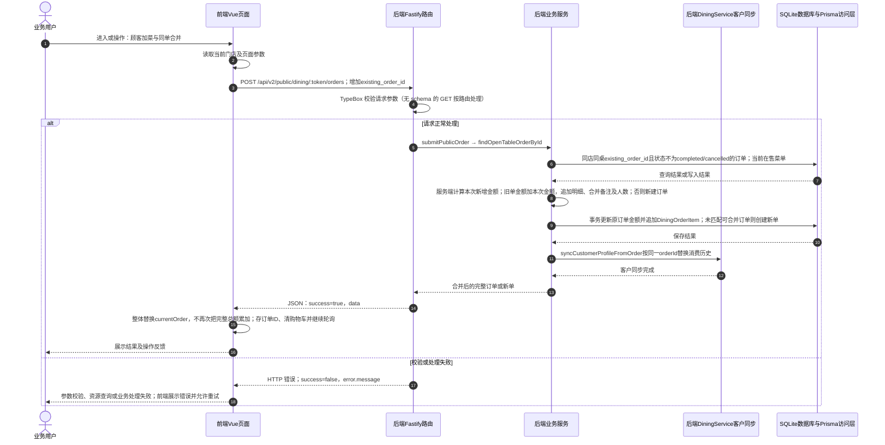

# ⑨ 扫码点餐与堂食订单 / 06 顾客加菜与同单合并

**实现状态：已实现** · 核对日期：2026-10-27

以下两图依据当前源码；仅对已存在链路作实现描述。尚未实现的范围在边界中说明。

## 业务范围与数据契约

| 项目 | 说明 |
| --- | --- |
| 入口与触发 | 手机已有未结束订单的加菜按钮 |
| 状态 | 已实现 |
| 接口与关键入参 | POST /api/v2/public/dining/:token/orders；增加existing_order_id |
| 主要调用 | submitPublicOrder → findOpenTableOrderById |
| 读取或写入数据 | 同店同桌existing_order_id且状态不为completed/cancelled的订单；当前在售菜单 |
| 核心处理 | 服务端计算本次新增金额；旧单金额加本次金额，追加明细、合并备注及人数；否则新建订单 |
| 响应与数据去向 | 合并后的完整订单或新单 |

## 业务流程图

```mermaid
flowchart TD
  N1(["开始"])
  N2["用户 → 前端页面<br/>进入或操作：顾客加菜与同单合并"]
  N3["前端页面内部处理<br/>读取当前门店及页面参数"]
  N4["前端页面 → 后端路由<br/>POST /api/v2/public/dining/:token/orders；增加existin<br/>g_order_id"]
  N5["后端路由内部处理<br/>TypeBox 校验请求参数（无 schema 的 GET 按路由处理）"]
  N6{"请求正常处理？"}
  N7["后端路由 → 业务服务<br/>submitPublicOrder → findOpenTableOrderById"]
  N8["业务服务 → 数据库<br/>同店同桌existing_order_id且状态不为completed/cancelled<br/>的订单；当前在售菜单"]
  N9["数据库 → 业务服务<br/>查询结果或写入结果"]
  N10["业务服务内部处理<br/>服务端计算本次新增金额；旧单金额加本次金额，追加明细、合并<br/>备注及人数；否则新建订单"]
  N11["业务服务 → 数据库<br/>事务更新原订单金额并追加DiningOrderItem；未匹配可合并订<br/>单则创建新单"]
  N12["数据库 → 业务服务<br/>保存结果"]
  N13["业务服务 → 客户同步<br/>syncCustomerProfileFromOrder按同一orderId替换消费历史"]
  N14["客户同步 → 业务服务<br/>客户同步完成"]
  N15["业务服务 → 后端路由<br/>合并后的完整订单或新单"]
  N16["后端路由 → 前端页面<br/>JSON：success=true，data"]
  N17["前端页面内部处理<br/>整体替换currentOrder，不再次把完整总额累加；存订单ID、清<br/>购物车并继续轮询"]
  N18["前端页面 → 用户<br/>展示结果及操作反馈"]
  N19["后端路由 → 前端页面<br/>HTTP 错误；success=false，error.message"]
  N20["前端页面 → 用户<br/>参数校验、资源查询或业务处理失败；前端展示错误并允许重试"]
  N21(["继续"])
  N22(["完成 / 可继续操作"])
  N1 -->|"用户 → 前端页面：调用或传递"| N2
  N2 -->|"前端页面内部处理"| N3
  N3 -->|"前端页面 → 后端路由：调用或传递"| N4
  N4 -->|"后端路由内部处理"| N5
  N5 --> N6
  N6 -->|"是 / 正常分支"| N7
  N7 -->|"业务服务 → 数据库：调用或传递"| N8
  N8 -.->|"数据库 → 业务服务：返回数据"| N9
  N9 -->|"业务服务内部处理"| N10
  N10 -->|"业务服务 → 数据库：调用或传递"| N11
  N11 -.->|"数据库 → 业务服务：返回数据"| N12
  N12 -->|"业务服务 → 客户同步：调用或传递"| N13
  N13 -.->|"客户同步 → 业务服务：返回数据"| N14
  N14 -.->|"业务服务 → 后端路由：返回数据"| N15
  N15 -.->|"后端路由 → 前端页面：返回数据"| N16
  N16 -->|"前端页面内部处理"| N17
  N17 -.->|"前端页面 → 用户：返回数据"| N18
  N6 -.->|"校验或处理失败"| N19
  N19 -.->|"前端页面 → 用户：返回数据"| N20
  N18 --> N21
  N20 --> N21
  N21 --> N22
  classDef user fill:#f8fafc,stroke:#64748b,color:#0f172a
  class N1,N18,N20,N22 user
  classDef front fill:#eff6ff,stroke:#60a5fa,color:#0f172a
  class N2,N3,N16,N17,N19 front
  classDef back fill:#fff7ed,stroke:#fb923c,color:#0f172a
  class N4,N5,N6,N7,N9,N10,N12,N13,N14,N15,N21 back
  classDef data fill:#f0fdf4,stroke:#4ade80,color:#0f172a
  class N8,N11 data
```

## 时序图

## 规则、异常与完成边界

新明细unitPrice来自当前菜单；旧明细价格不重写。可合并订单校验失败会回退创建新单；不是所有情况都报错。已出餐订单再加菜缺少完整差量补扣库存链路。

前端准备：读取当前门店及页面参数。

结果处理：整体替换currentOrder，不再次把完整总额累加；存订单ID、清购物车并继续轮询。

异常处理：参数校验、资源查询或业务处理失败；前端展示错误并允许重试。JSON、SSE和浏览器本地动作按各自协议反馈，失败不会凭空产生成功结果。

访问范围：顾客端凭有效桌台Token限定门店与桌台，不使用商户登录令牌。

## 源码与需求依据

- [backend/src/services/dining-service.ts:366](D:/餐小助/backend/src/services/dining-service.ts:366)
- [backend/src/routes/v2.ts:143](D:/餐小助/backend/src/routes/v2.ts:143)
- [front-pc/src/views/DiningOrdersView.vue:1](D:/餐小助/front-pc/src/views/DiningOrdersView.vue:1)
- [front-phone/src/views/DiningOrdersView.vue:1](D:/餐小助/front-phone/src/views/DiningOrdersView.vue:1)
- [front-phone/src/views/CustomerOrderView.vue:1](D:/餐小助/front-phone/src/views/CustomerOrderView.vue:1)

[返回模块与功能目录](../README.md)
