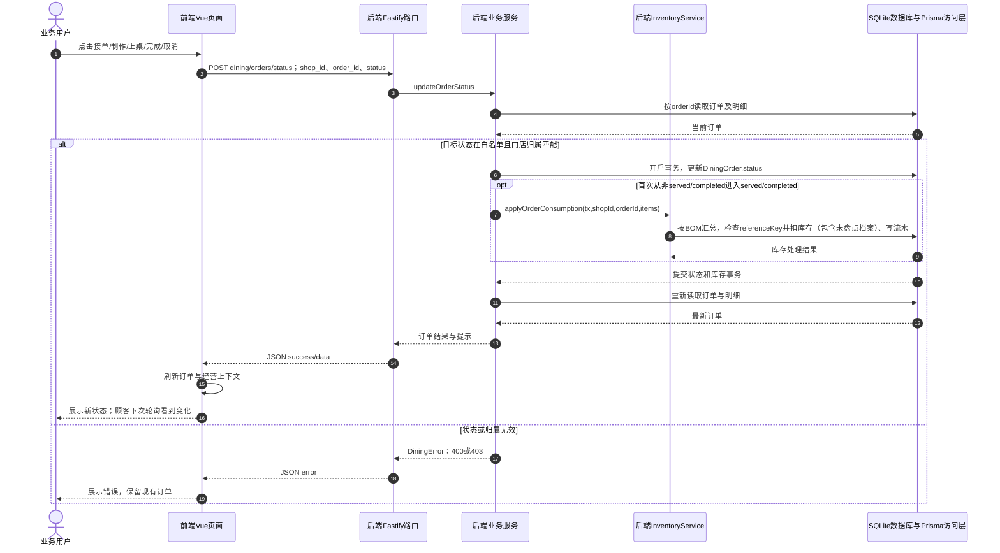

# ⑨ 扫码点餐与堂食订单 / 09 商户接单制作上桌完成与取消

**实现状态：已实现** · 核对日期：2026-10-27

以下两图依据当前源码；仅对已存在链路作实现描述。尚未实现的范围在边界中说明。

## 业务范围与数据契约

| 项目 | 说明 |
| --- | --- |
| 入口与触发 | PC及手机订单卡片状态按钮 |
| 状态 | 已实现 |
| 接口与关键入参 | POST /api/v2/dining/orders/status；{shop_id,order_id,status} |
| 主要调用 | updateOrderStatus |
| 读取或写入数据 | DiningOrder及明细，校验订单属于指定shopId |
| 核心处理 | 校验状态白名单；事务写状态，首次进入served/completed时触发用料扣减 |
| 响应与数据去向 | 更新订单、message |

## 业务流程图

```mermaid
flowchart TD
  N1(["开始"])
  N2["用户 → 前端页面<br/>点击接单/制作/上桌/完成/取消"]
  N3["前端页面 → 后端路由<br/>POST dining/orders/status；shop_id、order_id、status"]
  N4["后端路由 → 业务服务<br/>updateOrderStatus"]
  N5["业务服务 → 数据库<br/>按orderId读取订单及明细"]
  N6["数据库 → 业务服务<br/>当前订单"]
  N7{"目标状态在白名单且门店归属匹配？"}
  N8["业务服务 → 数据库<br/>开启事务，更新DiningOrder.status"]
  N9{"首次从非served/completed进入served/completed？"}
  N10["业务服务 → 库存服务<br/>applyOrderConsumption(tx,shopId,orderId,items)"]
  N11["库存服务 → 数据库<br/>按BOM汇总，检查referenceKey并扣库存（包含未盘点档案）、<br/>写流水"]
  N12["数据库 → 库存服务<br/>库存处理结果"]
  N13(["继续"])
  N14["数据库 → 业务服务<br/>提交状态和库存事务"]
  N15["业务服务 → 数据库<br/>重新读取订单与明细"]
  N16["数据库 → 业务服务<br/>最新订单"]
  N17["业务服务 → 后端路由<br/>订单结果与提示"]
  N18["后端路由 → 前端页面<br/>JSON success/data"]
  N19["前端页面内部处理<br/>刷新订单与经营上下文"]
  N20["前端页面 → 用户<br/>展示新状态；顾客下次轮询看到变化"]
  N21["业务服务 → 后端路由<br/>DiningError：400或403"]
  N22["后端路由 → 前端页面<br/>JSON error"]
  N23["前端页面 → 用户<br/>展示错误，保留现有订单"]
  N24(["继续"])
  N25(["完成 / 可继续操作"])
  N1 -->|"用户 → 前端页面：调用或传递"| N2
  N2 -->|"前端页面 → 后端路由：调用或传递"| N3
  N3 -->|"后端路由 → 业务服务：调用或传递"| N4
  N4 -->|"业务服务 → 数据库：调用或传递"| N5
  N5 -.->|"数据库 → 业务服务：返回数据"| N6
  N6 --> N7
  N7 -->|"是 / 正常分支"| N8
  N8 --> N9
  N9 -->|"是"| N10
  N10 -->|"库存服务 → 数据库：调用或传递"| N11
  N11 -.->|"数据库 → 库存服务：返回数据"| N12
  N12 --> N13
  N9 -->|"否 / 跳过"| N13
  N13 -.->|"数据库 → 业务服务：返回数据"| N14
  N14 -->|"业务服务 → 数据库：调用或传递"| N15
  N15 -.->|"数据库 → 业务服务：返回数据"| N16
  N16 -.->|"业务服务 → 后端路由：返回数据"| N17
  N17 -.->|"后端路由 → 前端页面：返回数据"| N18
  N18 -->|"前端页面内部处理"| N19
  N19 -.->|"前端页面 → 用户：返回数据"| N20
  N7 -.->|"状态或归属无效"| N21
  N21 -.->|"后端路由 → 前端页面：返回数据"| N22
  N22 -.->|"前端页面 → 用户：返回数据"| N23
  N20 --> N24
  N23 --> N24
  N24 --> N25
  classDef user fill:#f8fafc,stroke:#64748b,color:#0f172a
  class N1,N20,N23,N25 user
  classDef front fill:#eff6ff,stroke:#60a5fa,color:#0f172a
  class N2,N18,N19,N22 front
  classDef back fill:#fff7ed,stroke:#fb923c,color:#0f172a
  class N3,N4,N6,N7,N10,N12,N14,N16,N17,N21,N24 back
  classDef data fill:#f0fdf4,stroke:#4ade80,color:#0f172a
  class N5,N8,N9,N11,N13,N15 data
```

## 时序图

## 规则、异常与完成边界

典型业务顺序为pending→accepted→cooking→served→completed，cancelled为取消；代码只校验目标白名单与订单门店归属，没有逐状态合法迁移矩阵，因此不能宣称后端禁止跳跃或回退。取消不自动反冲已扣库存或客户档案；没有支付退款。

前端准备：读取当前门店及页面参数。

结果处理：更新 Pinia 或页面状态并渲染。

异常处理：参数校验、资源查询或业务处理失败；前端展示错误并允许重试。JSON、SSE和浏览器本地动作按各自协议反馈，失败不会凭空产生成功结果。

访问范围：此旧业务路由没有Agent/RAG同等的统一会话与门店鉴权；PC请求可携Bearer，但不能据此前端行为推断后端已核验。

## 源码与需求依据

- [backend/src/services/dining-service.ts:723](D:/餐小助/backend/src/services/dining-service.ts:723)
- [backend/src/routes/v2.ts:574](D:/餐小助/backend/src/routes/v2.ts:574)
- [front-pc/src/views/DiningOrdersView.vue:1](D:/餐小助/front-pc/src/views/DiningOrdersView.vue:1)
- [front-phone/src/views/DiningOrdersView.vue:1](D:/餐小助/front-phone/src/views/DiningOrdersView.vue:1)

[返回模块与功能目录](../README.md)
