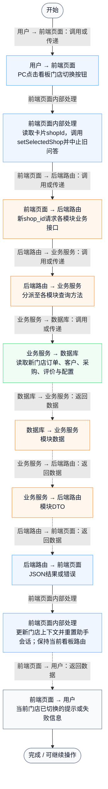
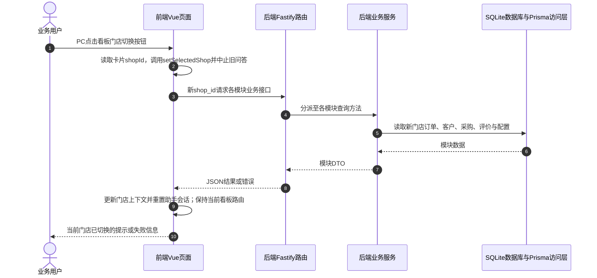

# ⑩ 多店经营看板 / 03 看板门店上下文切换

**实现状态：已实现** · 核对日期：2026-10-27

以下两图依据当前源码；仅对已存在链路作实现描述。尚未实现的范围在边界中说明。

## 业务范围与数据契约

| 项目 | 说明 |
| --- | --- |
| 入口与触发 | PC多店卡片切换门店按钮；手机看板无同等按钮 |
| 状态 | 已实现 |
| 接口与关键入参 | GET /api/v2/chain/board；后续各门店上下文接口 |
| 主要调用 | 前端openStore → setSelectedShop → refreshShopContext |
| 读取或写入数据 | 看板门店数据及所选门店业务数据 |
| 核心处理 | 取卡片shopId切换门店并导航至经营驾驶舱等页面 |
| 响应与数据去向 | 目标门店上下文与页面 |

## 业务流程图

## 时序图

## 规则、异常与完成边界

PC卡片调用setSelectedShop，清空旧门店数据后分模块加载，不自动导航离开多店看板。PC新增contextGeneration和请求ID拦截过期响应，助手会话与资料状态随门店重置。手机看板卡片仍只读。更名、删除与完整切换过程分别见⑧文档。

前端准备：读取当前门店及页面参数。

结果处理：切换当前selectedShopId和模块上下文；仍停留多店看板，可再通过侧栏进入单店模块。

异常处理：参数校验、资源查询或业务处理失败；前端展示错误并允许重试。JSON、SSE和浏览器本地动作按各自协议反馈，失败不会凭空产生成功结果。

访问范围：此旧业务路由没有Agent/RAG同等的统一会话与门店鉴权；PC请求可携Bearer，但不能据此前端行为推断后端已核验。

## 源码与需求依据

- [backend/src/services/merchant-service.ts:1](D:/餐小助/backend/src/services/merchant-service.ts:1)
- [backend/src/routes/v2.ts:783](D:/餐小助/backend/src/routes/v2.ts:783)
- [front-pc/src/views/ChainBoardView.vue:1](D:/餐小助/front-pc/src/views/ChainBoardView.vue:1)
- [front-phone/src/views/ChainBoardView.vue:1](D:/餐小助/front-phone/src/views/ChainBoardView.vue:1)
- [front-pc/src/stores/merchant.ts:632](D:/餐小助/front-pc/src/stores/merchant.ts:632)
- [front-pc/src/stores/merchant.ts:1](D:/餐小助/front-pc/src/stores/merchant.ts:1)

[返回模块与功能目录](../README.md)
