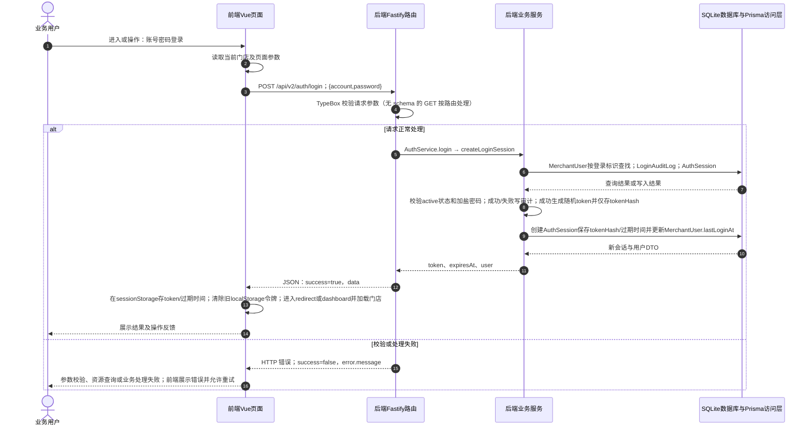

# ⑪ 账号认证与会话 / 01 账号密码登录

**实现状态：已实现** · 核对日期：2026-10-27

以下两图依据当前源码；仅对已存在链路作实现描述。尚未实现的范围在边界中说明。

## 业务范围与数据契约

| 项目 | 说明 |
| --- | --- |
| 入口与触发 | PC /login |
| 状态 | 已实现 |
| 接口与关键入参 | POST /api/v2/auth/login；{account,password} |
| 主要调用 | AuthService.login → createLoginSession |
| 读取或写入数据 | MerchantUser按登录标识查找；LoginAuditLog；AuthSession |
| 核心处理 | 校验active状态和加盐密码；成功/失败写审计；成功生成随机token并仅存tokenHash |
| 响应与数据去向 | token、expiresAt、user |

## 业务流程图

```mermaid
flowchart TD
  N1(["开始"])
  N2["用户 → 前端页面<br/>进入或操作：账号密码登录"]
  N3["前端页面内部处理<br/>读取当前门店及页面参数"]
  N4["前端页面 → 后端路由<br/>POST /api/v2/auth/login；{account,password}"]
  N5["后端路由内部处理<br/>TypeBox 校验请求参数（无 schema 的 GET 按路由处理）"]
  N6{"请求正常处理？"}
  N7["后端路由 → 业务服务<br/>AuthService.login → createLoginSession"]
  N8["业务服务 → 数据库<br/>MerchantUser按登录标识查找；LoginAuditLog；AuthSession"]
  N9["数据库 → 业务服务<br/>查询结果或写入结果"]
  N10["业务服务内部处理<br/>校验active状态和加盐密码；成功/失败写审计；成功生成随机to<br/>ken并仅存tokenHash"]
  N11["业务服务 → 数据库<br/>创建AuthSession保存tokenHash/过期时间并更新MerchantUse<br/>r.lastLoginAt"]
  N12["数据库 → 业务服务<br/>新会话与用户DTO"]
  N13["业务服务 → 后端路由<br/>token、expiresAt、user"]
  N14["后端路由 → 前端页面<br/>JSON：success=true，data"]
  N15["前端页面内部处理<br/>在sessionStorage存token/过期时间；清除旧localStorage令<br/>牌；进入redirect或dashboard并加载门店"]
  N16["前端页面 → 用户<br/>展示结果及操作反馈"]
  N17["后端路由 → 前端页面<br/>HTTP 错误；success=false，error.message"]
  N18["前端页面 → 用户<br/>参数校验、资源查询或业务处理失败；前端展示错误并允许重试"]
  N19(["继续"])
  N20(["完成 / 可继续操作"])
  N1 -->|"用户 → 前端页面：调用或传递"| N2
  N2 -->|"前端页面内部处理"| N3
  N3 -->|"前端页面 → 后端路由：调用或传递"| N4
  N4 -->|"后端路由内部处理"| N5
  N5 --> N6
  N6 -->|"是 / 正常分支"| N7
  N7 -->|"业务服务 → 数据库：调用或传递"| N8
  N8 -.->|"数据库 → 业务服务：返回数据"| N9
  N9 -->|"业务服务内部处理"| N10
  N10 -->|"业务服务 → 数据库：调用或传递"| N11
  N11 -.->|"数据库 → 业务服务：返回数据"| N12
  N12 -.->|"业务服务 → 后端路由：返回数据"| N13
  N13 -.->|"后端路由 → 前端页面：返回数据"| N14
  N14 -->|"前端页面内部处理"| N15
  N15 -.->|"前端页面 → 用户：返回数据"| N16
  N6 -.->|"校验或处理失败"| N17
  N17 -.->|"前端页面 → 用户：返回数据"| N18
  N16 --> N19
  N18 --> N19
  N19 --> N20
  classDef user fill:#f8fafc,stroke:#64748b,color:#0f172a
  class N1,N16,N18,N20 user
  classDef front fill:#eff6ff,stroke:#60a5fa,color:#0f172a
  class N2,N3,N14,N15,N17 front
  classDef back fill:#fff7ed,stroke:#fb923c,color:#0f172a
  class N4,N5,N6,N7,N9,N10,N12,N13,N19 back
  classDef data fill:#f0fdf4,stroke:#4ade80,color:#0f172a
  class N8,N11 data
```

## 时序图

## 规则、异常与完成边界

仅PC有完整登录页和会话store；手机端商户路由无同等登录守卫。成功会更新lastLoginAt；失败不给出账号是否存在的细分信息。

前端准备：读取当前门店及页面参数。

结果处理：在sessionStorage存token/过期时间；清除旧localStorage令牌；进入redirect或dashboard并加载门店。

异常处理：参数校验、资源查询或业务处理失败；前端展示错误并允许重试。JSON、SSE和浏览器本地动作按各自协议反馈，失败不会凭空产生成功结果。

访问范围：按本文件认证接口说明处理；登录、注册、短信与微信回调各自校验，不代表所有业务路由统一受保护。

## 源码与需求依据

- [backend/src/services/auth-service.ts:599](D:/餐小助/backend/src/services/auth-service.ts:599)
- [backend/src/routes/v2.ts:218](D:/餐小助/backend/src/routes/v2.ts:218)
- [front-pc/src/views/LoginView.vue:1](D:/餐小助/front-pc/src/views/LoginView.vue:1)
- [front-pc/src/views/RegisterView.vue:1](D:/餐小助/front-pc/src/views/RegisterView.vue:1)
- [front-pc/src/views/WechatCallbackView.vue:1](D:/餐小助/front-pc/src/views/WechatCallbackView.vue:1)

[返回模块与功能目录](../README.md)
