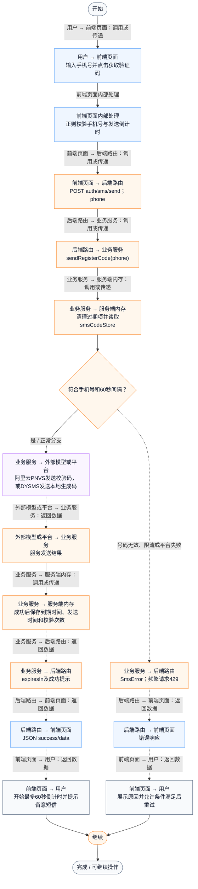
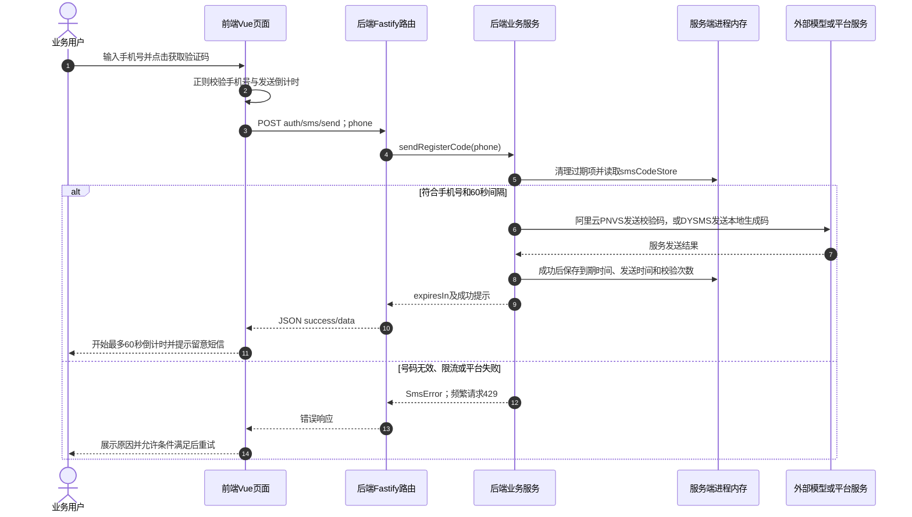

# ⑪ 账号认证与会话 / 02 注册短信验证码发送

**实现状态：已实现** · 核对日期：2026-10-27

以下两图依据当前源码；仅对已存在链路作实现描述。尚未实现的范围在边界中说明。

## 业务范围与数据契约

| 项目 | 说明 |
| --- | --- |
| 入口与触发 | PC /register 获取验证码 |
| 状态 | 已实现 |
| 接口与关键入参 | POST /api/v2/auth/sms/send；{phone} |
| 主要调用 | SmsService.sendRegisterCode |
| 读取或写入数据 | 进程内smsCodeStore：频率、过期时间、尝试次数 |
| 核心处理 | 校验手机号；同号码60秒发送间隔；按配置使用阿里云PNVS或DYSMS |
| 响应与数据去向 | status、message、expiresIn |

## 业务流程图

## 时序图

## 规则、异常与完成边界

短信服务必须真实配置。PNVS由平台管理验证码；DYSMS由本地生成后发送。验证码状态只存在进程内存，不是数据库持久化或多实例共享。

前端准备：读取当前门店及页面参数。

结果处理：更新 Pinia 或页面状态并渲染。

异常处理：参数校验、资源查询或业务处理失败；前端展示错误并允许重试。JSON、SSE和浏览器本地动作按各自协议反馈，失败不会凭空产生成功结果。

访问范围：按本文件认证接口说明处理；登录、注册、短信与微信回调各自校验，不代表所有业务路由统一受保护。

## 源码与需求依据

- [backend/src/services/sms-service.ts:228](D:/餐小助/backend/src/services/sms-service.ts:228)
- [backend/src/routes/v2.ts:302](D:/餐小助/backend/src/routes/v2.ts:302)
- [front-pc/src/views/LoginView.vue:1](D:/餐小助/front-pc/src/views/LoginView.vue:1)
- [front-pc/src/views/RegisterView.vue:1](D:/餐小助/front-pc/src/views/RegisterView.vue:1)
- [front-pc/src/views/WechatCallbackView.vue:1](D:/餐小助/front-pc/src/views/WechatCallbackView.vue:1)

[返回模块与功能目录](../README.md)
