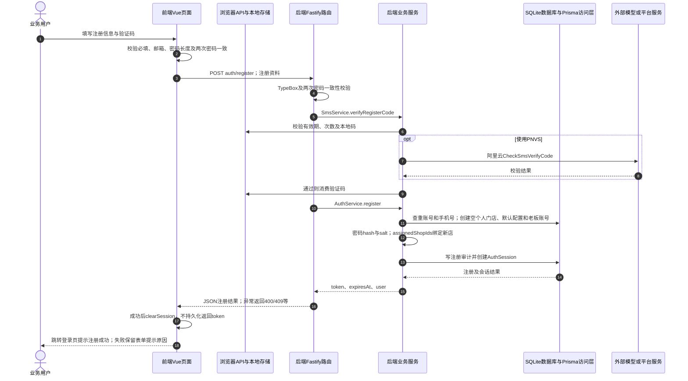

# ⑪ 账号认证与会话 / 03 账号注册与个人门店初始化

**实现状态：已实现** · 核对日期：2026-10-27

以下两图依据当前源码；仅对已存在链路作实现描述。尚未实现的范围在边界中说明。

## 业务范围与数据契约

| 项目 | 说明 |
| --- | --- |
| 入口与触发 | PC /register |
| 状态 | 已实现 |
| 接口与关键入参 | POST /api/v2/auth/register；{account,phone,email?,password,confirm_password,sms_code,display_name?} |
| 主要调用 | verifyRegisterCode → AuthService.register |
| 读取或写入数据 | 短信内存状态、MerchantUser唯一账号/手机号、Shop与默认配置 |
| 核心处理 | 验证验证码、密码及账号，创建个人门店和老板账号，生成审计与登录会话 |
| 响应与数据去向 | 后端返回token、expiresAt、user；前端最终返回登录页 |

## 业务流程图

```mermaid
flowchart TD
  N1(["开始"])
  N2["用户 → 前端页面<br/>填写注册信息与验证码"]
  N3["前端页面内部处理<br/>校验必填、邮箱、密码长度及两次密码一致"]
  N4["前端页面 → 后端路由<br/>POST auth/register；注册资料"]
  N5["后端路由内部处理<br/>TypeBox及两次密码一致性校验"]
  N6["后端路由 → 业务服务<br/>SmsService.verifyRegisterCode"]
  N7["业务服务 → 浏览器<br/>校验有效期、次数及本地码"]
  N8{"使用PNVS？"}
  N9["业务服务 → 外部模型或平台<br/>阿里云CheckSmsVerifyCode"]
  N10["外部模型或平台 → 业务服务<br/>校验结果"]
  N11(["继续"])
  N12["业务服务 → 浏览器<br/>通过则消费验证码"]
  N13["后端路由 → 业务服务<br/>AuthService.register"]
  N14["业务服务 → 数据库<br/>查重账号和手机号；创建空个人门店、默认配置和老板账号"]
  N15["业务服务内部处理<br/>密码hash与salt；assignedShopIds绑定新店"]
  N16["业务服务 → 数据库<br/>写注册审计并创建AuthSession"]
  N17["数据库 → 业务服务<br/>注册及会话结果"]
  N18["业务服务 → 后端路由<br/>token、expiresAt、user"]
  N19["后端路由 → 前端页面<br/>JSON注册结果；异常返回400/409等"]
  N20["前端页面内部处理<br/>成功后clearSession，不持久化返回token"]
  N21["前端页面 → 用户<br/>跳转登录页提示注册成功；失败保留表单提示原因"]
  N22(["完成 / 可继续操作"])
  N1 -->|"用户 → 前端页面：调用或传递"| N2
  N2 -->|"前端页面内部处理"| N3
  N3 -->|"前端页面 → 后端路由：调用或传递"| N4
  N4 -->|"后端路由内部处理"| N5
  N5 -->|"后端路由 → 业务服务：调用或传递"| N6
  N6 -->|"业务服务 → 浏览器：调用或传递"| N7
  N7 --> N8
  N8 -->|"是"| N9
  N9 -.->|"外部模型或平台 → 业务服务：返回数据"| N10
  N10 --> N11
  N8 -->|"否 / 跳过"| N11
  N11 -->|"业务服务 → 浏览器：调用或传递"| N12
  N12 -->|"后端路由 → 业务服务：调用或传递"| N13
  N13 -->|"业务服务 → 数据库：调用或传递"| N14
  N14 -->|"业务服务内部处理"| N15
  N15 -->|"业务服务 → 数据库：调用或传递"| N16
  N16 -.->|"数据库 → 业务服务：返回数据"| N17
  N17 -.->|"业务服务 → 后端路由：返回数据"| N18
  N18 -.->|"后端路由 → 前端页面：返回数据"| N19
  N19 -->|"前端页面内部处理"| N20
  N20 -.->|"前端页面 → 用户：返回数据"| N21
  N21 --> N22
  classDef user fill:#f8fafc,stroke:#64748b,color:#0f172a
  class N1,N21,N22 user
  classDef front fill:#eff6ff,stroke:#60a5fa,color:#0f172a
  class N2,N3,N7,N8,N11,N12,N19,N20 front
  classDef back fill:#fff7ed,stroke:#fb923c,color:#0f172a
  class N4,N5,N6,N10,N13,N15,N17,N18 back
  classDef data fill:#f0fdf4,stroke:#4ade80,color:#0f172a
  class N14,N16 data
  classDef external fill:#faf5ff,stroke:#c084fc,color:#0f172a
  class N9 external
```

## 时序图

## 规则、异常与完成边界

后端确实创建会话，但前端authStore.register主动clearSession，不保留返回token；随后跳/login?registered=1&account=...。验证码成功校验会被消费，即使后续注册失败也可能需重新获取。

前端准备：读取当前门店及页面参数。

结果处理：更新 Pinia 或页面状态并渲染。

异常处理：参数校验、资源查询或业务处理失败；前端展示错误并允许重试。JSON、SSE和浏览器本地动作按各自协议反馈，失败不会凭空产生成功结果。

访问范围：按本文件认证接口说明处理；登录、注册、短信与微信回调各自校验，不代表所有业务路由统一受保护。

## 源码与需求依据

- [backend/src/services/auth-service.ts:1](D:/餐小助/backend/src/services/auth-service.ts:1)
- [backend/src/routes/v2.ts:324](D:/餐小助/backend/src/routes/v2.ts:324)
- [front-pc/src/views/LoginView.vue:1](D:/餐小助/front-pc/src/views/LoginView.vue:1)
- [front-pc/src/views/RegisterView.vue:1](D:/餐小助/front-pc/src/views/RegisterView.vue:1)
- [front-pc/src/views/WechatCallbackView.vue:1](D:/餐小助/front-pc/src/views/WechatCallbackView.vue:1)
- [front-pc/src/stores/auth.ts:1](D:/餐小助/front-pc/src/stores/auth.ts:1)

[返回模块与功能目录](../README.md)
