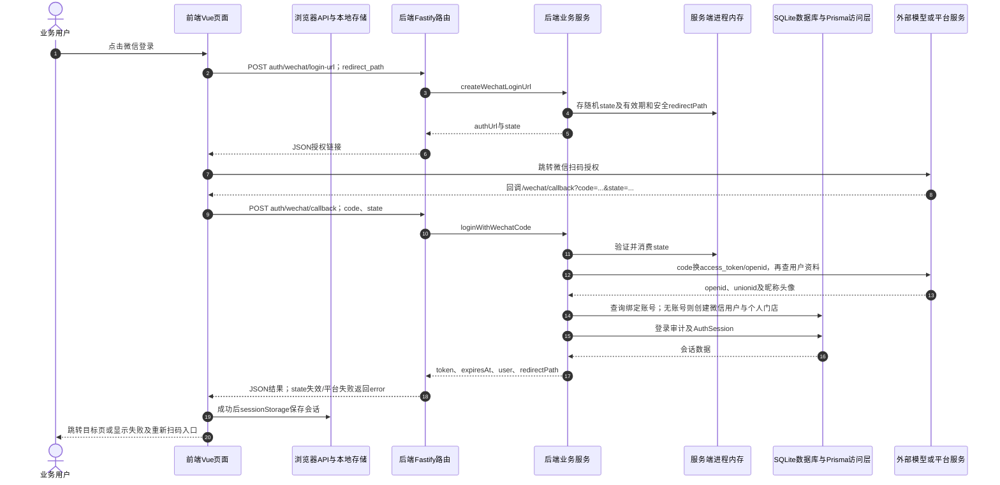

# ⑪ 账号认证与会话 / 04 微信扫码登录与回调

**实现状态：已实现** · 核对日期：2026-10-27

以下两图依据当前源码；仅对已存在链路作实现描述。尚未实现的范围在边界中说明。

## 业务范围与数据契约

| 项目 | 说明 |
| --- | --- |
| 入口与触发 | PC登录页微信按钮；/wechat/callback |
| 状态 | 已实现 |
| 接口与关键入参 | POST /api/v2/auth/wechat/login-url；POST /api/v2/auth/wechat/callback |
| 主要调用 | createWechatLoginUrl → loginWithWechatCode |
| 读取或写入数据 | 进程内wechatLoginStates、MerchantUser微信标识、AuthSession |
| 核心处理 | 生成限时state；code换access_token和用户信息；按openid/unionid找账号或创建新个人店账号 |
| 响应与数据去向 | authUrl、state；回调返回token、user、redirectPath |

## 业务流程图

```mermaid
flowchart TD
  N1(["开始"])
  N2["用户 → 前端页面<br/>点击微信登录"]
  N3["前端页面 → 后端路由<br/>POST auth/wechat/login-url；redirect_path"]
  N4["后端路由 → 业务服务<br/>createWechatLoginUrl"]
  N5["业务服务 → 服务端内存<br/>存随机state及有效期和安全redirectPath"]
  N6["业务服务 → 后端路由<br/>authUrl与state"]
  N7["后端路由 → 前端页面<br/>JSON授权链接"]
  N8["前端页面 → 外部模型或平台<br/>跳转微信扫码授权"]
  N9["外部模型或平台 → 前端页面<br/>回调/wechat/callback?code=...&amp;state=..."]
  N10["前端页面 → 后端路由<br/>POST auth/wechat/callback；code、state"]
  N11["后端路由 → 业务服务<br/>loginWithWechatCode"]
  N12["业务服务 → 服务端内存<br/>验证并消费state"]
  N13["业务服务 → 外部模型或平台<br/>code换access_token/openid，再查用户资料"]
  N14["外部模型或平台 → 业务服务<br/>openid、unionid及昵称头像"]
  N15["业务服务 → 数据库<br/>查询绑定账号；无账号则创建微信用户与个人门店"]
  N16["业务服务 → 数据库<br/>登录审计及AuthSession"]
  N17["数据库 → 业务服务<br/>会话数据"]
  N18["业务服务 → 后端路由<br/>token、expiresAt、user、redirectPath"]
  N19["后端路由 → 前端页面<br/>JSON结果；state失效/平台失败返回error"]
  N20["前端页面 → 浏览器<br/>成功后sessionStorage保存会话"]
  N21["前端页面 → 用户<br/>跳转目标页或显示失败及重新扫码入口"]
  N22(["完成 / 可继续操作"])
  N1 -->|"用户 → 前端页面：调用或传递"| N2
  N2 -->|"前端页面 → 后端路由：调用或传递"| N3
  N3 -->|"后端路由 → 业务服务：调用或传递"| N4
  N4 -->|"业务服务 → 服务端内存：调用或传递"| N5
  N5 -.->|"业务服务 → 后端路由：返回数据"| N6
  N6 -.->|"后端路由 → 前端页面：返回数据"| N7
  N7 -->|"前端页面 → 外部模型或平台：调用或传递"| N8
  N8 -.->|"外部模型或平台 → 前端页面：返回数据"| N9
  N9 -->|"前端页面 → 后端路由：调用或传递"| N10
  N10 -->|"后端路由 → 业务服务：调用或传递"| N11
  N11 -->|"业务服务 → 服务端内存：调用或传递"| N12
  N12 -->|"业务服务 → 外部模型或平台：调用或传递"| N13
  N13 -.->|"外部模型或平台 → 业务服务：返回数据"| N14
  N14 -->|"业务服务 → 数据库：调用或传递"| N15
  N15 -->|"业务服务 → 数据库：调用或传递"| N16
  N16 -.->|"数据库 → 业务服务：返回数据"| N17
  N17 -.->|"业务服务 → 后端路由：返回数据"| N18
  N18 -.->|"后端路由 → 前端页面：返回数据"| N19
  N19 -->|"前端页面 → 浏览器：调用或传递"| N20
  N20 -.->|"前端页面 → 用户：返回数据"| N21
  N21 --> N22
  classDef user fill:#f8fafc,stroke:#64748b,color:#0f172a
  class N1,N21,N22 user
  classDef front fill:#eff6ff,stroke:#60a5fa,color:#0f172a
  class N2,N7,N9,N19,N20 front
  classDef back fill:#fff7ed,stroke:#fb923c,color:#0f172a
  class N3,N4,N5,N6,N10,N11,N12,N14,N17,N18 back
  classDef data fill:#f0fdf4,stroke:#4ade80,color:#0f172a
  class N15,N16 data
  classDef external fill:#faf5ff,stroke:#c084fc,color:#0f172a
  class N8,N13 external
```

## 时序图

## 规则、异常与完成边界

需配置微信开放平台应用与回调地址。state一次消费且存于单进程内存；微信商户登录不等同于顾客OneID或平台订单接入。

前端准备：读取当前门店及页面参数。

结果处理：更新 Pinia 或页面状态并渲染。

异常处理：参数校验、资源查询或业务处理失败；前端展示错误并允许重试。JSON、SSE和浏览器本地动作按各自协议反馈，失败不会凭空产生成功结果。

访问范围：按本文件认证接口说明处理；登录、注册、短信与微信回调各自校验，不代表所有业务路由统一受保护。

## 源码与需求依据

- [backend/src/services/auth-service.ts:690](D:/餐小助/backend/src/services/auth-service.ts:690)
- [backend/src/routes/v2.ts:249](D:/餐小助/backend/src/routes/v2.ts:249)
- [front-pc/src/views/LoginView.vue:1](D:/餐小助/front-pc/src/views/LoginView.vue:1)
- [front-pc/src/views/RegisterView.vue:1](D:/餐小助/front-pc/src/views/RegisterView.vue:1)
- [front-pc/src/views/WechatCallbackView.vue:1](D:/餐小助/front-pc/src/views/WechatCallbackView.vue:1)

[返回模块与功能目录](../README.md)
